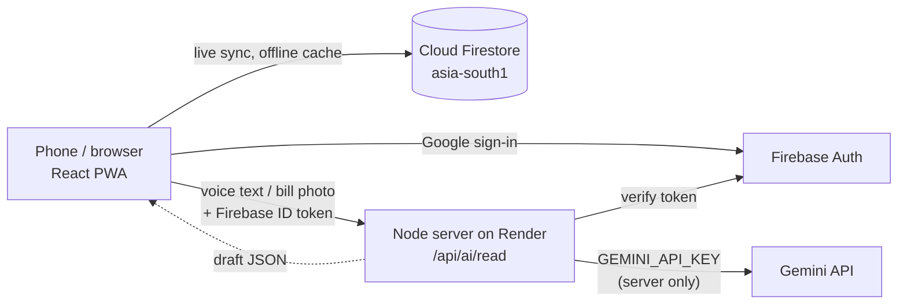
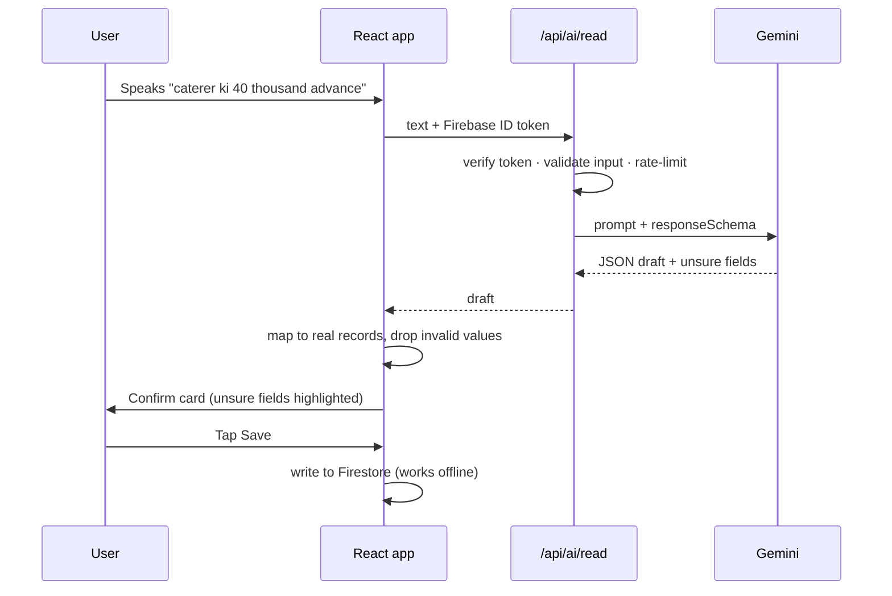

<div align="center">

# 💍 Vivah Khata

### The shared family ledger for Indian weddings — expenses, vendor dues and the gift register, in Telugu, Hindi and English, powered by Google Gemini.

[](https://github.com/vinay2214-cloud/vivahkhata/actions)


**[▶ Live app](https://vivahkhata.onrender.com)** · **[🎬 2-minute demo video](https://youtu.be/5LD-ClOqqC8)** · **[📦 Source](https://github.com/vinay2214-cloud/vivahkhata)**


_One wedding. One shared ledger. The whole family contributing._

</div>

---

## Table of contents

1. [Try it in 60 seconds](#-try-it-in-60-seconds)
2. [The problem](#-the-problem)
3. [Who it is for](#-who-it-is-for)
4. [The solution](#-the-solution)
5. [How Google Gemini is used](#-how-google-gemini-is-used)
6. [Architecture](#-architecture)
7. [Tech stack](#-tech-stack)
8. [Evaluation criteria at a glance](#-evaluation-criteria-at-a-glance)
9. [Code quality](#-code-quality)
10. [Security](#-security)
11. [Efficiency](#-efficiency)
12. [Accessibility](#-accessibility)
13. [Testing](#-testing)
14. [Run it locally](#-run-it-locally)
15. [Project structure](#-project-structure)
16. [Responsible AI](#-responsible-ai)
17. [Known limits](#-known-limits)
18. [Roadmap](#-roadmap)
19. [License](#-license)

---

## ⚡ Try it in 60 seconds

1. Open **https://vivahkhata.onrender.com** (the free host sleeps when idle, so the first load can take up to a minute).
2. Tap **Explore Demo Mode**. No sign-up is needed.
3. Create a wedding, then tap **Load sample wedding**. Vendors, dues, expenses and 17 gift envelopes appear.
4. Try these:
   - **Speak an expense**, e.g. _"caterer ki 40 thousand advance ichhamu cash lo"_.
   - **Scan a bill** or UPI screenshot.
   - Open **Gift Desk Mode**, then tap **Thank** on any gift for a Gemini-written WhatsApp message.
   - See **Settle up** on the home screen.
   - Switch the language to **తెలుగు** or **हिन्दी**.

---

## 🎯 The problem

An Indian wedding is run by a **whole family**, not one person.

- **5–15 relatives pay** for things in cash, UPI and card, as advances and balances.
- Spending is spread over **4–6 events**, dozens of **vendors** and hundreds of **guests**.
- On the wedding day, **hundreds of gift envelopes** (_chadivimpulu / moi / shagun_) are written by hand in one notebook.

**What goes wrong:**

| Pain                                      | Consequence                                                                     |
| ----------------------------------------- | ------------------------------------------------------------------------------- |
| No single record of who paid what         | Nobody knows the real total; relatives argue afterwards                         |
| Vendor schedules live in heads and chats  | Balances are missed or paid twice                                               |
| Gift notebook is handwritten              | It gets lost or becomes illegible, yet families use it for years to reciprocate |
| Elders are not comfortable typing English | The people who hold the money cannot use typical apps                           |

Existing wedding apps help you **find** vendors. None help a family **run the money together**.

## 👨‍👩‍👧 Who it is for

- **The family treasurer** (often a parent) who needs one true total.
- **Relatives who pay** and want their contribution recorded.
- **The gift-table volunteer** on the wedding day, who needs speed and must work without signal.
- **Elders** who prefer speaking Telugu or Hindi to typing English.

---

## 💡 The solution

Vivah Khata is a **mobile-first, installable web app (PWA)** in which the family shares one live ledger.

| Feature                                     | What it does                                                                                                                                             |
| ------------------------------------------- | -------------------------------------------------------------------------------------------------------------------------------------------------------- |
| 🧾 **Shared expenses**                      | Record a payment in seconds: amount, category, event, who paid, cash/UPI/card, advance/balance and a receipt photo. Totals update live for everyone.     |
| 🎙️ **Speak it in Telugu, Hindi or English** | _"caterer ki 40 thousand advance ichhamu cash lo"_ → Gemini fills ₹40,000 · Catering · Cash · Advance. You check it and tap Save.                        |
| 📷 **Scan a bill or UPI screenshot**        | Gemini reads the total, payee, date and UPI reference. Duplicate UPI payments are flagged.                                                               |
| 🤝 **Vendors and dues**                     | Agreed amount, payment schedule, what is paid, what is overdue, plus one-tap call and WhatsApp.                                                          |
| 🎁 **Gift Desk Mode**                       | A big-button, offline-proof screen for the gift table: name → amount → Save & Next.                                                                      |
| 📖 **Permanent gift register**              | Search it years later ("what did Ramesh garu give us?") and export it to CSV.                                                                            |
| 💌 **Thank-you messages with Gemini**       | Tap **Thank** on a gift and Gemini writes a short, warm WhatsApp message in your language. It never mentions the amount, and you edit it before sending. |
| ⚖️ **Settle up**                            | When several relatives paid, it shows the fewest transfers that make everyone even.                                                                      |
| 🔁 **Repeat givers**                        | Guests who gave at more than one event are shown once, with a combined total.                                                                            |
| 👥 **Family roles and invites**             | Owner, Editor, Contributor, Gift Desk and Viewer roles, invited by WhatsApp link.                                                                        |
| 📶 **Works offline**                        | Saves on the phone in a function hall with no signal, and syncs when back online.                                                                        |
| 🌐 **Trilingual**                           | Full English, తెలుగు and हिन्दी interface, with Indian number format (₹1,23,456).                                                                        |

> **Responsible by design:** AI results are always a draft that the user confirms, and nothing is saved automatically. The app refuses to record dowry, which is illegal under the Dowry Prohibition Act, 1961.

---

## 🤖 How Google Gemini is used

| Where                                                  | Model and settings                             | Purpose                                                                                                                                                        |
| ------------------------------------------------------ | ---------------------------------------------- | -------------------------------------------------------------------------------------------------------------------------------------------------------------- |
| **Voice entry** (`server/prompts.ts` → `VOICE_PROMPT`) | `gemini-3.5-flash`, JSON mode, temperature 0.1 | Turns code-mixed Telugu/Hindi/English speech into a structured expense or gift. Understands Indian number words (_vela, laksha_) and relatives (_mama, anna_). |
| **Bill and UPI screenshot reading** (`RECEIPT_PROMPT`) | Gemini multimodal, JSON mode                   | Extracts the grand total (not the subtotal or GST), payee, date and UPI reference. Rejects failed or pending payments and quotations.                          |
| **Structured output** (`server/gemini.ts`)             | `responseSchema`                               | Guarantees machine-readable output. The model also lists fields it is unsure about, and the app highlights them.                                               |
| **Thank-you messages** (`THANKS_PROMPT`)               | `gemini-3.5-flash`, temperature 0.6            | Short, personal message in English, Telugu or Hindi. The prompt forbids stating the amount, inventing facts or mentioning dowry.                               |
| **Draft safety** (`src/lib/aiDraft.ts`)                | Rules                                          | Maps names to real vendor, member and event records. Drops impossible amounts, invalid dates and unknown categories.                                           |
| **Offline fallback** (`src/lib/aiParser.ts`)           | Rules                                          | With no network, a rule-based reader fills only what it is sure of.                                                                                            |

Other Google services used:

- **Firebase Authentication** for Google sign-in and anonymous demo mode.
- **Cloud Firestore** in asia-south1, with offline persistence and role-based security rules.

---

## 🏗️ Architecture



**One AI request, step by step:**



**Design decisions:**

- **Data goes straight from the browser to Firestore**, protected by `firestore.rules`. This means offline support and live sync come for free.
- **The server only does what needs a secret.** It verifies the token, validates input, rate-limits, calls Gemini and returns a draft. It never writes wedding data.
- **Money is integer paise everywhere**, so there are no floating-point errors in totals.
- **Nothing is hard-deleted.** Every record carries `createdBy`, `updatedBy` and `deleted` audit fields.

---

## 🧰 Tech stack

| Layer         | Technology                                                                    |
| ------------- | ----------------------------------------------------------------------------- |
| Frontend      | React 19, TypeScript (strict), Vite, Tailwind CSS 4, i18next                  |
| Data and auth | Cloud Firestore (offline persistence), Firebase Authentication                |
| AI            | Google Gemini via `@google/genai` (JSON `responseSchema`, multimodal)         |
| Backend       | Node.js 22, Express, `jose` for Firebase ID-token verification                |
| Quality       | ESLint (typescript-eslint, react-hooks), Prettier, EditorConfig               |
| Testing       | Vitest, coverage-v8, real HTTP route tests against a running server, axe-core |
| CI/CD         | GitHub Actions → Render (auto-deploy from `main`)                             |

---

## ✅ Evaluation criteria at a glance

Every claim below can be checked in the repository or by running the commands shown.

| Criterion                       | Evidence                                                                                                                                                       | Where                                                |
| ------------------------------- | -------------------------------------------------------------------------------------------------------------------------------------------------------------- | ---------------------------------------------------- |
| **Problem-statement alignment** | A specific Indian problem (a family running one wedding's money and gift register), with Telugu/Hindi/English, UPI, lakh/crore formatting and a dowry refusal. | [Problem](#-the-problem), [Solution](#-the-solution) |
| **Code quality**                | Layered architecture, zero `any`, central logger, typed errors, small focused components, ESLint and Prettier enforced in CI.                                  | [Code quality](#-code-quality)                       |
| **Security**                    | Server-only API key, ID-token verification, input validation, rate limits, security headers, role-based Firestore rules, `npm audit` in CI.                    | [Security](#-security)                               |
| **Efficiency**                  | Integer-paise maths, on-device totals, image compression, lazy AI module, offline cache.                                                                       | [Efficiency](#-efficiency)                           |
| **Testing**                     | 81 tests in 14 files, about 84% line coverage, real HTTP route tests, run on every push.                                                                       | [Testing](#-testing)                                 |
| **Accessibility**               | axe-core scan of the sign-in screen with 0 WCAG 2 A/AA violations, labelled dialogs, focus management, live regions, reduced motion, 48px targets.             | [Accessibility](#-accessibility)                     |
| **Google services**             | Gemini (text and vision), Firebase Auth, Cloud Firestore.                                                                                                      | [Gemini](#-how-google-gemini-is-used)                |

---

## 🧹 Code quality

- **Layered structure:**
  - `src/pages` and `src/components` only render. Large screens are split into focused components, e.g. `src/pages/money/*` and `src/components/dashboard/*`.
  - `src/services` is the only code that writes to Firestore, so audit fields and soft delete live in one place.
  - `src/domain` and `src/lib` hold pure, unit-tested business logic (totals, dues, settle-up, filters, money).
  - `server/` is a small Express app built with dependency injection (`createApp(deps)`), so tests exercise real routes with a fake Gemini.
- **Strict typing.** There is no `any`, and `@typescript-eslint/no-explicit-any` is an error. Caught errors are `unknown` and are converted by `errorMessage()`. Firestore timestamps use a `FirestoreTime` type. The browser speech API is wrapped in a typed interface.
- **One way to log.** Components never call `console.*`. They use `src/lib/logger.ts`, and the `no-console` rule enforces this.
- **Resilience.** A top-level `ErrorBoundary` shows a recovery screen instead of a blank page. AI failures fall back to the offline reader.
- **Automated gates.** `npm run lint` (ESLint and `tsc`) and `npm run format:check` (Prettier) run in CI on every push.
- **Documented conventions.** See [CONTRIBUTING.md](CONTRIBUTING.md).

---

## 🔒 Security

- **Secrets stay on the server.** `GEMINI_API_KEY` lives only in Render's environment and is never in the repo or the browser bundle. Firebase web settings are public by design.
- **Every AI request is authenticated.** The server verifies the Firebase ID token's signature, issuer and audience with `jose` and Google's public keys.
- **Input validation** (`server/validate.ts`):
  - request kinds are whitelisted;
  - text is limited to 1,000 characters;
  - images are limited to about 2.2 MB, with base64 and MIME-type checks;
  - JSON bodies are limited to 4 MB.
- **Per-user rate limiting.** The default is 40 AI reads per hour (configurable), which protects the Gemini quota.
- **Role-based Firestore rules:**
  - only invited members can read a wedding;
  - viewers cannot write;
  - contributors edit only their own entries;
  - Gift Desk volunteers can add gifts and correct their own for 15 minutes;
  - invites expire and can be revoked.
- **Security headers.** `nosniff`, `X-Frame-Options: DENY`, a strict referrer policy, a permissions policy and HSTS in production are set, and `x-powered-by` is removed.
- **Privacy and dependencies.** Notes and photos are never logged. `npm audit --omit=dev` reports 0 vulnerabilities, and the check runs in CI.

---

## 🚀 Efficiency

- **Integer paise.** Exact sums with no rounding drift.
- **On-device totals.** Totals are computed from data already synced, so they need no extra reads and work offline.
- **Images.** Photos are compressed on the phone (to at most 1600px) before upload.
- **Lazy loading.** The AI module loads only when used, and the app loads only after the Firebase config is verified.
- **Caching.** Assets are fingerprinted and cached for a year, and the app installs to the home screen.

---

## ♿ Accessibility

- **Automated scan.** axe-core checks the sign-in screen and finds 0 WCAG 2 A/AA violations in light and dark themes. Signed-in screens use the same components and were checked by hand.
- **Dialogs.** They use `role="dialog"`, `aria-modal` and labelled titles, close on **Escape**, and return focus to the button that opened them.
- **Screen readers.** Save confirmations are announced (`aria-live`), icon-only buttons have labels, and the mic button exposes its pressed state.
- **Keyboard.** A visible focus ring appears everywhere.
- **Motion.** Animations are disabled for users who prefer reduced motion.
- **Elder-friendly design.** 16px base text, 48px touch targets and high-contrast colours. The page `lang` attribute switches for Telugu and Hindi.

---

## 🧪 Testing

```bash
npm test               # 81 unit + API tests (Vitest)
npm run test:coverage  # ~84% line coverage
```

| Test file                     | Covers                                                                                                                 |
| ----------------------------- | ---------------------------------------------------------------------------------------------------------------------- |
| `tests/money.test.ts`         | Paise conversion, Indian lakh/crore formatting, gold weights                                                           |
| `tests/totals.test.ts`        | Spent and remaining, splits by category/event/payer/mode, vendor dues, gift totals, soft-deleted data excluded         |
| `tests/vendorBalance.test.ts` | Paid, due and overdue schedule rows, progress, overpayment                                                             |
| `tests/dues.test.ts`          | Pending instalments: overdue first, paid ones excluded                                                                 |
| `tests/expenseFilter.test.ts` | Expense search, category filter and day grouping                                                                       |
| `tests/permissions.test.ts`   | Every role's capabilities and the 15-minute Gift Desk edit window                                                      |
| `tests/aiDraft.test.ts`       | Mapping Gemini output to real records; rejecting invented categories, bad amounts and dates                            |
| `tests/offlineParser.test.ts` | Telugu/Hindi/English amounts, gifts and gold; never invents values; refuses dowry                                      |
| `tests/pendingInvite.test.ts` | Invite links survive sign-in; malformed codes rejected                                                                 |
| `tests/settle.test.ts`        | Settle-up transfers always sum to zero; repeat-giver totals; deleted gifts ignored                                     |
| `tests/thanks.test.ts`        | Thank-you template never contains an amount; WhatsApp link; server validation of the request                           |
| `tests/i18n.test.ts`          | Telugu and Hindi cover every English key and keep `{{placeholders}}`                                                   |
| `tests/errors.test.ts`        | Error-message helper, Firestore timestamp reader, logger                                                               |
| `tests/server.test.ts`        | Real HTTP routes: 401 without or with a forged token, 400 bad input, 429 rate limit, 503 without key, security headers |

**Continuous integration** (`.github/workflows/ci.yml`) runs on every push: ESLint → type-check → Prettier check → tests with coverage → production build → dependency audit.

---

## 🛠️ Run it locally

**Prerequisites:** Node.js 22, a Firebase project (Auth + Firestore) and a Gemini API key from [Google AI Studio](https://aistudio.google.com/apikey).

```bash
git clone https://github.com/vinay2214-cloud/vivahkhata.git
cd vivahkhata
npm install
cp .env.example .env.local   # fill in the values below
npm run dev:server           # AI server on :8787
npm run dev                  # app on http://localhost:3000
```

| Variable                   | Where it is used | Purpose                                   |
| -------------------------- | ---------------- | ----------------------------------------- |
| `GEMINI_API_KEY`           | Server only      | Gemini access (never sent to the browser) |
| `GEMINI_MODEL`             | Server           | Defaults to `gemini-3.5-flash`            |
| `AI_LIMIT_PER_HOUR`        | Server           | Per-user AI rate limit (default 40)       |
| `VITE_FIREBASE_API_KEY`    | Browser          | Firebase web app key (public by design)   |
| `VITE_FIREBASE_APP_ID`     | Browser          | Firebase web app id                       |
| `VITE_FIREBASE_PROJECT_ID` | Browser          | Firebase project                          |

| Script                  | What it does                    |
| ----------------------- | ------------------------------- |
| `npm run lint`          | ESLint + TypeScript type-check  |
| `npm run format:check`  | Prettier check                  |
| `npm test`              | Run the test suite              |
| `npm run test:coverage` | Tests with a coverage report    |
| `npm run build`         | Production build (app + server) |

Deploying (Firebase + Render, free tier): see **[DEPLOY-GUIDE.md](DEPLOY-GUIDE.md)**.

---

## 📁 Project structure

```
vivahkhata/
├── server/                 # Express API: only what needs a secret
│   ├── app.ts              # routes, auth check, rate limit, security headers
│   ├── gemini.ts           # Gemini request + responseSchema
│   ├── prompts.ts          # voice, receipt and thank-you instructions
│   └── validate.ts         # input validation and rate limiter
├── src/
│   ├── pages/              # screens (Dashboard, Money, Gift Desk, Register, …)
│   │   └── money/          # Expenses, Vendors, Budget tabs
│   ├── components/         # UI by feature: ai, dashboard, expense, gift, vendor, ui
│   ├── services/           # the only Firestore writers (audit fields, soft delete)
│   ├── domain/             # pure business logic: totals, dues, settle-up, filters
│   ├── lib/                # money, dates, AI draft safety, offline parser, logger
│   ├── context/            # auth and live wedding data
│   └── i18n/               # en, te, hi translations
├── tests/                  # Vitest suite (81 tests)
├── firestore.rules         # role-based security rules
└── .github/workflows/ci.yml
```

---

## 🛡️ Responsible AI

- **Human in the loop.** Every AI result is a draft on a confirm screen, and nothing is saved without a tap.
- **No guessing.** The model reports the fields it is unsure about, those are highlighted, and unknown values stay blank.
- **Grounded output.** Names are matched only to real records. Invented categories, impossible amounts and invalid dates are dropped.
- **Dignity in messages.** Thank-you messages never mention the amount, and the user edits them before sending.
- **Legal and ethical guard.** Dowry is refused, by both the AI path and the offline parser.
- **Privacy.** Prompts and photos are not logged, and the AI server stores nothing.

## ⚠️ Known limits

- The free Render host sleeps when idle, so the first request can take up to a minute.
- Gemini output can be wrong, which is why it is always a draft the person confirms.
- The automated accessibility scan covers the sign-in screen. Signed-in screens were checked by hand.
- In-browser speech recognition depends on the device. Chrome on Android works best.

## 🗺️ Roadmap

- Guest list with RSVP and return-gift tracking.
- Printable gift register (PDF) for the family archive.
- Shared receipts folder with search.
- More languages: Tamil, Kannada and Marathi.

## 📄 License

[MIT](LICENSE) © 2026 Vinay Janyavula. Built for Hack2Skill PromptWars with Google Gemini and Firebase.
