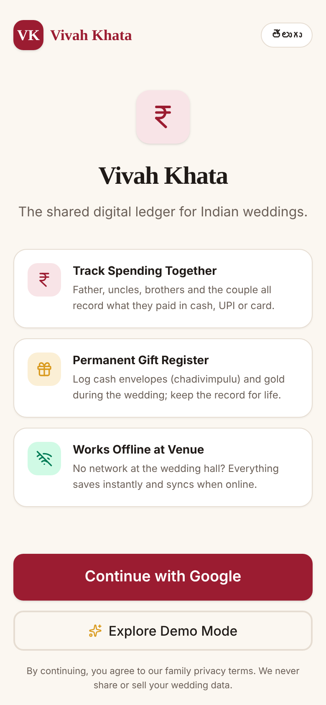
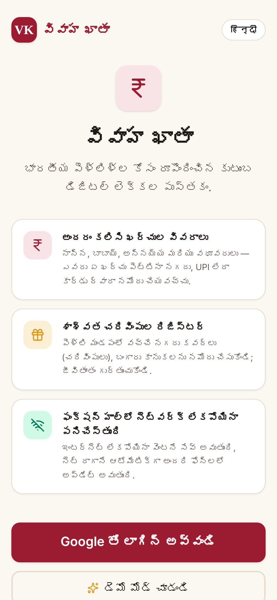
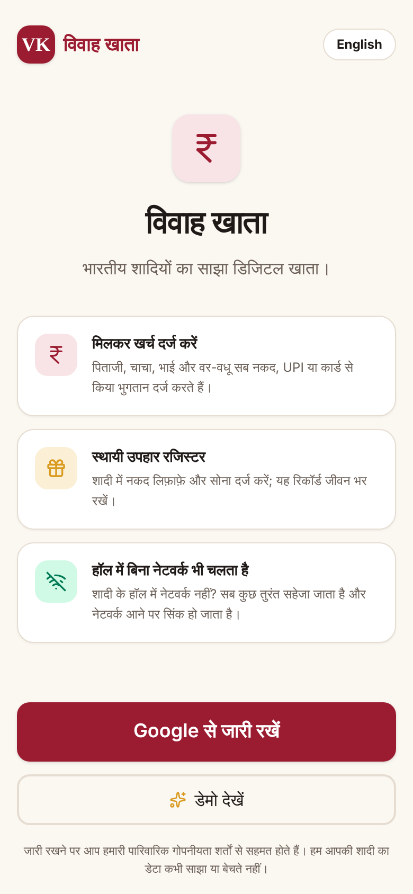
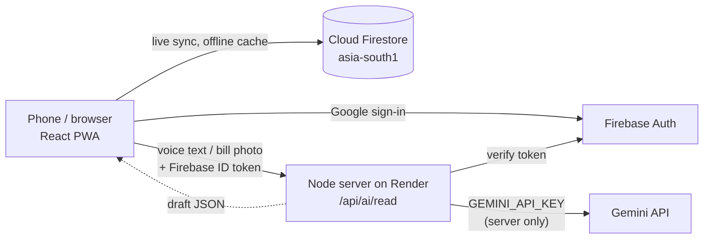

# Vivah Khata — the family wedding ledger

[](https://github.com/vinay2214-cloud/vivahkhata/actions)   

**Live app:** https://vivahkhata.onrender.com · **Stack:** React + TypeScript · Firebase · Node/Express · Google Gemini

> One wedding. One shared ledger. The whole family contributing.

<p align="center">
  
  
  
</p>

**Demo video:** https://youtu.be/5LD-ClOqqC8 (2 min) · **Try it in 30 seconds:** open the live app → _Explore Demo Mode_ → create a wedding → _Load sample wedding_. (The free host sleeps when idle; the first load can take up to a minute.)

## Evaluation criteria at a glance

Every claim below can be checked in the repository or by running the commands shown.

| Criterion                       | What we did                                                                                                                                                                                                                                                                                                                                       | Where to verify                                                          |
| ------------------------------- | ------------------------------------------------------------------------------------------------------------------------------------------------------------------------------------------------------------------------------------------------------------------------------------------------------------------------------------------------- | ------------------------------------------------------------------------ |
| **Problem-statement alignment** | Solves a real, specific Indian problem: a whole family running one wedding's money and gift register. Telugu/Hindi/English, UPI, lakh/crore formatting, the gift notebook, and a hard refusal to record dowry.                                                                                                                                    | [The problem](#the-problem), [The solution](#the-solution)               |
| **Code quality**                | Strict separation of UI, services, pure domain logic and server. Zero `any` in the codebase (`@typescript-eslint/no-explicit-any` is an error), no raw `console.*` (central `logger`), typed Firestore timestamps, typed Web Speech wrapper, shared `errorMessage()` helper, an `ErrorBoundary`, ESLint + Prettier + EditorConfig enforced in CI. | [Code quality](#code-quality), `eslint.config.js`, `.prettierrc.json`    |
| **Security**                    | Server-held API key, Firebase ID-token verification, input validation, per-user rate limits, security headers, role-based Firestore rules, soft deletes, `npm audit` in CI.                                                                                                                                                                       | [Security](#security), `firestore.rules`, `server/`                      |
| **Efficiency**                  | Integer-paise maths, on-device totals, compressed photos, lazy AI module, cached static assets, offline Firestore cache.                                                                                                                                                                                                                          | [Efficiency](#efficiency)                                                |
| **Testing**                     | 81 tests in 14 files (~84% line coverage) covering money, totals, permissions, AI draft mapping, offline parser, settle-up, thank-yous, i18n parity and real HTTP routes; run on every push.                                                                                                                                                      | [Testing](#testing), `.github/workflows/ci.yml`                          |
| **Accessibility**               | axe-core scan of the sign-in screen (0 WCAG 2 A/AA violations, light and dark), labelled dialogs, Escape to close, focus return, live-region announcements, reduced-motion support, 48px targets.                                                                                                                                                 | [Accessibility](#accessibility)                                          |
| **Use of Google services**      | Gemini (voice, bill reading, thank-yous) with a JSON `responseSchema`; Firebase Auth; Cloud Firestore with security rules and offline persistence.                                                                                                                                                                                                | [How Gen AI is used](#how-gen-ai-is-used), [Architecture](#architecture) |

## Code quality

- **Layered structure.** `src/pages` and `src/components` render (large screens are split into focused components, e.g. `src/pages/money/*`, `src/components/dashboard/*`); `src/services` is the only code that writes to Firestore (audit fields and soft delete in one place); `src/domain` and `src/lib` hold pure, tested functions; `server/` is a small Express app built with dependency injection (`createApp(deps)`) so tests exercise real routes with a fake Gemini.
- **Strict typing.** No `any`. Caught errors are `unknown` and converted with `errorMessage()`; Firestore timestamps use a `FirestoreTime` type and `timeToDate()`; the browser speech API is wrapped in a small typed interface; timers use `ReturnType<typeof setInterval>`.
- **One way to log.** Components never call `console.*`; they use `src/lib/logger.ts`. ESLint enforces it (`no-console`).
- **Automated style.** `npm run lint` runs ESLint (typescript-eslint, react-hooks rules) and `tsc`; `npm run format:check` runs Prettier. Both run in CI.
- **Resilience.** A top-level `ErrorBoundary` shows a recovery screen instead of a blank page; AI failures fall back to an offline rule-based reader.
- **Documented conventions.** See [CONTRIBUTING.md](CONTRIBUTING.md) (money is paise, writes go through services, AI output is always a draft, three locale files).
- **Clean repo.** MIT [LICENSE](LICENSE), `.editorconfig`, `.env.example`, no dead files or unused imports.

## The problem

An Indian wedding is run by a whole family, not one person. Five to fifteen relatives pay for things — in cash, UPI and card, as advances and balances — across 4–6 events, dozens of vendors and hundreds of guests. On the wedding day, hundreds of gift envelopes (_chadivimpulu / moi / shagun_) arrive and are written by hand in one notebook.

The result: nobody knows the real total, vendor balances are missed, family members argue over who paid what, and the gift record that families use for years to reciprocate is often lost or illegible. Existing wedding apps help you _find_ vendors; none help a family _run the money_ together.

## The solution

Vivah Khata is a mobile-first, installable web app where the family shares one live ledger:

| Feature                                  | What it does                                                                                                                                            |
| ---------------------------------------- | ------------------------------------------------------------------------------------------------------------------------------------------------------- |
| **Shared expenses**                      | Anyone records a payment in seconds: amount, category, event, who paid, cash/UPI/card, advance/balance, receipt photo. Totals update live for everyone. |
| **Speak it in Telugu, Hindi or English** | Say _"caterer ki 40 thousand advance ichhamu cash lo"_ → Gemini fills ₹40,000 · Catering · Cash · Advance. The person checks and taps Save.             |
| **Scan a bill or UPI screenshot**        | Gemini reads the total, payee, date and UPI reference from a photo; duplicate UPI payments are flagged.                                                 |
| **Vendors & dues**                       | Agreed amount, payment schedule, what's paid, what's overdue.                                                                                           |
| **Gift Desk Mode**                       | A big-button, offline-proof screen for the volunteer at the gift table: name → amount → Save & Next.                                                    |
| **Permanent gift register**              | Search years later: "what did Ramesh garu give us?"                                                                                                     |
| **Family roles & invites**               | Owner, Editor, Contributor, Gift Desk, Viewer — invited by WhatsApp link.                                                                               |
| **Works offline**                        | Saves on the phone in a function hall with no signal, syncs when back online.                                                                           |
| **Thank-you messages with Gemini**       | Tap _Thank_ on any gift → Gemini writes a warm, short WhatsApp message in Telugu, Hindi or English (never mentioning the amount) → edit → send.         |
| **Settle up**                            | When 5 relatives paid, shows the fewest transfers that make everyone even (integer paise, tested).                                                      |
| **Repeat givers**                        | Guests who gave at more than one event appear once, with a combined total.                                                                              |
| **Trilingual**                           | Full English, తెలుగు and हिन्दी interface; Indian number format (₹1,23,456).                                                                            |
| **One-tap demo**                         | "Explore Demo Mode" → _Load sample wedding_ fills vendors, dues, expenses and 17 gift envelopes.                                                        |

**Responsible by design:** AI results are always a draft the user confirms — nothing is saved automatically, and unknown values stay blank instead of being guessed. The app refuses to record dowry (illegal under the Dowry Prohibition Act, 1961).

## How Gen AI is used

| Where                                              | Model                                         | Purpose                                                                                                                                                                                                                         |
| -------------------------------------------------- | --------------------------------------------- | ------------------------------------------------------------------------------------------------------------------------------------------------------------------------------------------------------------------------------- |
| Voice entry (`server/prompts.ts` → `VOICE_PROMPT`) | Gemini (`gemini-3.5-flash`)                   | Turns code-mixed Telugu/Hindi/English speech into a structured expense or gift, understanding Indian number words (_vela, laksha, nara_) and relatives (_mama, anna_).                                                          |
| Bill & UPI screenshot reading (`RECEIPT_PROMPT`)   | Gemini multimodal                             | Extracts grand total (not subtotal/GST), payee, date, UPI reference; rejects failed/pending payments and quotations.                                                                                                            |
| Structured output (`server/gemini.ts`)             | `responseSchema` + JSON mode, temperature 0.1 | Guarantees machine-readable output; the model also lists the fields it is unsure about, which the app highlights for the user.                                                                                                  |
| Matching (`src/lib/aiDraft.ts`)                    | —                                             | Maps spoken names to the real vendor, family member and event records; drops impossible amounts, invalid dates and unknown categories.                                                                                          |
| Thank-you messages (`THANKS_PROMPT`)               | Gemini (`gemini-3.5-flash`, temperature 0.6)  | Writes a short personal message in English, Telugu or Hindi. The prompt forbids stating the amount, inventing facts or mentioning dowry; the person edits before sending. Template fallback when offline (`src/lib/thanks.ts`). |
| Offline fallback (`src/lib/aiParser.ts`)           | Rules                                         | When there is no network, a rule-based reader fills only what it is sure of.                                                                                                                                                    |

## Architecture



- **Data** goes straight from the browser to Firestore and is protected by role-based security rules (`firestore.rules`).
- **The server** only does what needs a secret: it verifies the user's Firebase ID token, validates input, rate-limits, calls Gemini and returns a draft. It never writes wedding data.

## Security

- **Secrets stay server-side.** `GEMINI_API_KEY` lives only in Render's environment; it is never in the repo or the browser bundle. Firebase web settings are public by design and come from build-time environment variables.
- **Every AI request is authenticated.** The server verifies the Firebase ID token signature, issuer and audience (`jose`, Google public keys) before doing anything.
- **Input validation and limits** (`server/validate.ts`): request kind whitelist, text ≤ 1,000 chars, images ≤ ~2.2 MB, base64 and MIME-type checks, JSON body limit 4 MB.
- **Per-user rate limiting** (40 AI reads/hour, configurable) protects the Gemini quota.
- **Role-based access in Firestore rules:** only invited members can read a wedding; viewers cannot write; contributors edit only their own entries; Gift Desk volunteers can add gifts and correct their own for 15 minutes; documents are owner/editor only; invites expire and can be revoked; nothing is hard-deleted.
- **Security headers:** `nosniff`, `X-Frame-Options: DENY`, strict referrer policy, permissions policy, HSTS in production, `x-powered-by` removed.
- **Privacy:** notes and photos are never logged — only success/failure. `npm audit --omit=dev` reports 0 vulnerabilities (a vulnerable transitive gRPC package is pinned to a patched version via `overrides`).

## Accessibility

- Automated **axe-core** scan of the sign-in screen: **0 WCAG 2 A/AA violations** in light and dark themes (signed-in screens are built with the same components and checked by hand).
- Dialogs use `role="dialog"`, `aria-modal`, labelled titles, close on **Escape** and return focus to the button that opened them.
- Save confirmations are announced to screen readers (`aria-live`); icon-only buttons have labels; the mic button exposes its pressed state.
- Visible keyboard focus ring everywhere; animations are disabled for users who prefer reduced motion.
- Elder-friendly: 16px base text, 48px touch targets, high-contrast colours; page language switches to `te` for Telugu.

## Efficiency

- Money is stored as integer paise — no floating-point errors in totals.
- Totals are computed on the device from data already synced (works offline, no extra reads).
- Photos are compressed on the phone (≤1600px) before upload; the AI module is lazy-loaded only when used.
- Static assets are fingerprinted and cached for a year; the app shell installs to the home screen.

## Testing

```bash
npm test               # 81 unit + API tests (Vitest)
npm run test:coverage  # ~84% line coverage of business logic and server
```

| Test file                     | Covers                                                                                                       |
| ----------------------------- | ------------------------------------------------------------------------------------------------------------ |
| `tests/money.test.ts`         | Paise conversion, Indian lakh/crore formatting, gold weights                                                 |
| `tests/totals.test.ts`        | Spent/remaining, splits by category/event/payer/mode, vendor dues, gift totals; soft-deleted data excluded   |
| `tests/vendorBalance.test.ts` | Paid / due / overdue schedule rows, progress, overpayment                                                    |
| `tests/permissions.test.ts`   | Every role's capabilities; 15-minute Gift Desk edit window                                                   |
| `tests/aiDraft.test.ts`       | Mapping Gemini output to real records; rejecting invented categories, bad amounts and dates                  |
| `tests/offlineParser.test.ts` | Telugu/Hindi/English amounts, gifts, gold; never invents values; refuses dowry                               |
| `tests/pendingInvite.test.ts` | Invite links survive sign-in; malformed codes rejected                                                       |
| `tests/settle.test.ts`        | Settle-up transfers always sum to zero, repeat-giver totals, deleted gifts ignored                           |
| `tests/thanks.test.ts`        | Thank-you template never contains an amount, WhatsApp link, server validation of the thank-you request       |
| `tests/expenseFilter.test.ts` | Expense search/category filter and day grouping                                                              |
| `tests/dues.test.ts`          | Pending vendor instalments: overdue first, paid ones excluded                                                |
| `tests/errors.test.ts`        | Error-message helper, Firestore timestamp reader, logger                                                     |
| `tests/i18n.test.ts`          | Telugu and Hindi cover every English key and keep `{{placeholders}}`                                         |
| `tests/server.test.ts`        | Real HTTP routes: 401 without/forged token, 400 bad input, 429 rate limit, 503 without key, security headers |

GitHub Actions (`.github/workflows/ci.yml`) runs ESLint, type-check, Prettier check, tests with coverage, a production build and a dependency audit on every push.

## Run it yourself

```bash
npm install
cp .env.example .env.local   # add GEMINI_API_KEY and the two VITE_FIREBASE_* values
npm run dev:server           # AI server on :8787
npm run dev                  # app on http://localhost:3000
npm test
npm run lint && npm run format:check   # quality gates used in CI
```

Deploying: see **[DEPLOY-GUIDE.md](DEPLOY-GUIDE.md)** (Firebase + Render, free tier).

## Project layout

| Path                                    | What it is                                               |
| --------------------------------------- | -------------------------------------------------------- |
| `src/pages`, `src/components`           | Screens and UI components                                |
| `src/services`                          | All Firestore writes (audit fields, soft delete)         |
| `src/domain`                            | Pure calculations: totals, vendor balances               |
| `src/lib/errors.ts`, `logger.ts`        | Typed error messages, timestamp reader, central logging  |
| `src/lib/aiDraft.ts`                    | Turns AI output into a safe, user-confirmed draft        |
| `src/lib/aiParser.ts`                   | Offline fallback reader                                  |
| `server/app.ts`                         | Express routes, auth check, rate limit, security headers |
| `server/gemini.ts`, `server/prompts.ts` | Gemini request, schema and instructions                  |
| `server/validate.ts`                    | Input validation and rate limiter                        |
| `firestore.rules`                       | Role-based security rules                                |
| `tests/`                                | Vitest suite                                             |

## Honest limits

- The free Render host sleeps when idle; the first request can take up to a minute.
- Gemini output can be wrong, which is why it is always a draft the person confirms.
- The automated accessibility scan covers the sign-in screen; signed-in screens use the same components and were checked by hand.
- Voice recognition in the browser depends on the device (Chrome on Android works best).

## License

[MIT](LICENSE) © 2026 Vinay Janyavula
